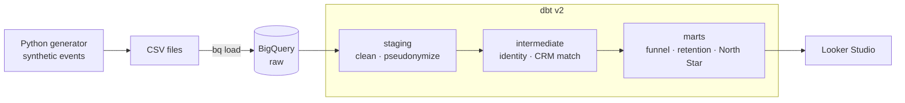

# B2B product analytics: QuoteBridge

[](https://www.getdbt.com/)
[](https://cloud.google.com/bigquery)
[](https://www.python.org/)
[](https://docs.astral.sh/uv/)

End-to-end product analytics for a fictional B2B workflow product, built with **Python, BigQuery and dbt**.

QuoteBridge lets insurance agencies request quotes from several carriers, compare them and bind a policy. This project answers the questions a product team asks: how many policies the platform drives (North Star), where users drop off in the quote funnel, which accounts keep coming back, and how much data client-side tracking loses compared to server-side.

🚧 Work in progress (see [Roadmap](#roadmap)).

## What it covers

- **Event tracking design:** a [tracking plan](docs/tracking_plan.md) with client-side and server-side events.
- **Identity resolution:** stitching `anonymous_id` → `user_id`, and matching product accounts to CRM accounts that use a different id and messy domains.
- **Pseudonymization:** emails are hashed with a salted SHA-256 in staging; no raw personal data reaches the marts.
- **Modeling in dbt:** staging → intermediate → marts, with tests and documentation.
- **Product metrics:** North Star, funnel, cohort retention ([definitions](docs/metrics.md)).
- **Dashboard:** Looker Studio on top of the marts.

## Architecture



## Models

| Model | Layer | Type | What it is | Status |
|---|---|---|---|---|
| `stg_app__accounts` | staging | view | Product accounts (agencies), normalized domain | ✅ |
| `stg_app__users` | staging | view | Users, email replaced by a salted hash | ✅ |
| `stg_app__frontend_events` | staging | view | Client-side events | ✅ |
| `stg_app__server_events` | staging | view | Server-side events, source of truth for quotes | ✅ |
| `stg_crm__accounts` | staging | view | CRM accounts, normalized domain | ✅ |
| `int_identity__anonymous_to_user` | intermediate | view | First user seen on each `anonymous_id` | ✅ |
| `int_accounts__crm_matched` | intermediate | view | Product accounts matched to the CRM by domain | ✅ |
| `int_events__unified` | intermediate | view | Client + server events in one stream | 🚧 |
| `fct_quote_funnel` | marts | table | One row per quote, funnel steps and tracking loss | 🚧 |
| `fct_account_retention` | marts | table | Weekly cohort retention | 🚧 |
| `metric_north_star_weekly` | marts | table | Policies bound per week | 🚧 |
| `dim_accounts` | marts | table | One row per account, with CRM fields | 🚧 |

All models have descriptions and tests (`unique`, `not_null`, `relationships`, plus a singular test that fails if the CRM match rate drops below 85%).

Datasets are split by environment: `dev` builds into `dev_staging`, `dev_intermediate` and `dev_marts`; `prod` builds into `staging`, `intermediate` and `marts`.

## Run it

```bash
# 1. Install dbt and generate synthetic data (standard library only)
uv sync
uv run python generator/generate_events.py --accounts 120 --days 120 --seed 42

# 2. Load to BigQuery (sandbox / free tier is enough)
bq mk --location=US --dataset YOUR_GCP_PROJECT:raw
for t in app_accounts app_users crm_accounts frontend_events server_events; do
  bq load --replace --autodetect --source_format=CSV raw.$t data/raw/$t.csv
done

# 3. Build and test the models
cd dbt
uv run dbt debug
uv run dbt build                  # dev
uv run dbt build --target prod    # prod
```

dbt looks for a profile called `quotebridge_analytics` in `~/.dbt/profiles.yml`. Copy the block from [`dbt/profiles.example.yml`](dbt/profiles.example.yml) and set your GCP project.

The generated CSVs are not in the repo (they're in `.gitignore`). The same `--seed` always produces the same data.

## Roadmap

- [x] Synthetic data generator with realistic tracking problems
- [x] Tracking plan and metric definitions
- [x] Staging models with pseudonymization and tests
- [x] Identity stitching (`int_identity__anonymous_to_user`)
- [x] Product ↔ CRM account matching with a match-rate test
- [ ] Quote funnel and client vs server tracking loss
- [ ] Weekly cohort retention
- [ ] North Star weekly metric
- [ ] Looker Studio dashboard + screenshots
